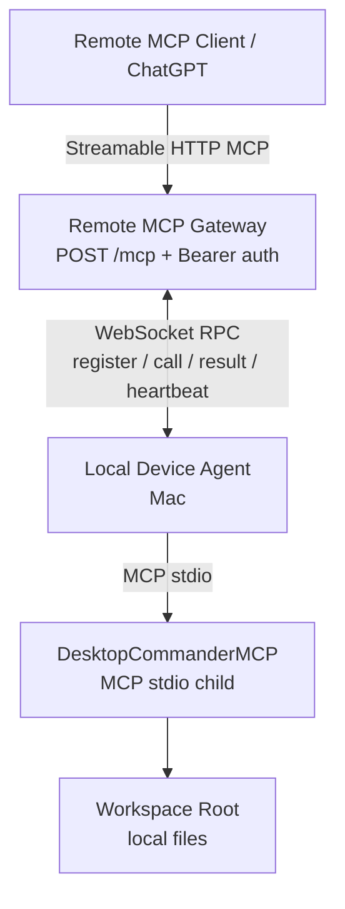

# open-remote-desktop-mcp

`open-remote-desktop-mcp` is a small, single-user Remote MCP gateway for a local Mac running [DesktopCommanderMCP](https://github.com/wonderwhy-er/DesktopCommanderMCP). It proxies the local Desktop Commander tool catalog over WebSocket and exposes it through a standard Streamable HTTP MCP endpoint.

The gateway never reads or writes the local filesystem. The local Agent starts DesktopCommanderMCP over stdio, validates workspace paths, and executes the tool calls on the Mac.

## Architecture



## Current scope

- Node.js 22+, TypeScript, pnpm workspace.
- One gateway, one device, one user.
- Streamable HTTP MCP at `/mcp`.
- WebSocket device channel at `/device`.
- Dynamic `tools/list` catalog from DesktopCommanderMCP.
- Default tool allowlist for file/search operations.
- Optional process tools with `ENABLE_SHELL=true`.
- Bearer API token for MCP clients and a separate device token for Agents.
- Heartbeat timeout, reconnect backoff, per-call timeout, and structured error codes.
- `WORKSPACE_ROOT` enforcement using `realpath`, including symlink escape protection.

This first phase intentionally does not include AWS IoT, MQTT, databases, OAuth, multi-user routing, a web UI, billing, or the official Desktop Commander Remote service.

## Install

```bash
pnpm install
pnpm build
cp .env.example .env
```

Set `MCP_API_TOKEN` and `DEVICE_TOKEN` to different, long random values. The two processes can use the same `.env` file for a local test:

```bash
set -a
source .env
set +a
```

The `pnpm gateway` and `pnpm agent` scripts load `.env` automatically on Node.js 22+, so the `source` step is only needed when starting the TypeScript entrypoints manually.

## Run locally

Terminal 1 — Gateway:

```bash
pnpm gateway
```

Terminal 2 — Agent:

```bash
pnpm agent
```

The Agent launches:

```bash
npx -y @wonderwhy-er/desktop-commander@latest
```

It then calls `tools/list`, registers the filtered catalog with the Gateway, and reconnects with exponential backoff after a disconnect.

Terminal 3 — full E2E:

```bash
pnpm test:e2e
```

The E2E script uses `/tmp/remote-mcp-e2e`, starts both processes, verifies tools/list, write/read/edit, path isolation, offline detection, and Agent reconnect. It downloads the Desktop Commander package through `npx` on first use.

Expected output includes:

```text
Gateway: online
Device e2e-mac: online
Desktop Commander: connected
tools/list: PASS
Remote write: PASS
Remote read: PASS
Remote edit: PASS
Path isolation: PASS
Agent offline detection: PASS
Device offline call: PASS
Reconnect: PASS
```

Unit tests for workspace path isolation:

```bash
node --test --import tsx tests/path-security.test.ts
```

To verify any local, tunneled, or public endpoint before adding it to ChatGPT:

```bash
MCP_ENDPOINT=https://your-host.example/mcp pnpm verify:remote
```

## Configuration

| Variable | Used by | Meaning |
| --- | --- | --- |
| `PORT` | Gateway | HTTP/WebSocket port, default `8787` |
| `MCP_API_TOKEN` | Gateway/client | Bearer token for `/mcp` |
| `DEVICE_ID` | Agent | Stable device name |
| `DEVICE_TOKEN` | Gateway/Agent | Separate token for WebSocket registration |
| `GATEWAY_URL` | Agent | WebSocket URL, for example `ws://localhost:8787/device` |
| `WORKSPACE_ROOT` | Agent | Filesystem boundary for file tools |
| `ENABLE_SHELL` | Gateway/Agent | Defaults to `false`; exposes process tools only when `true` |
| `CALL_TIMEOUT_MS` | Gateway | Per-call timeout, default `30000` |

The Gateway defaults to exposing:

```text
list_directory
read_file
read_multiple_files
get_file_info
start_search
get_more_search_results
stop_search
write_file
edit_block
create_directory
move_file
```

When `ENABLE_SHELL=true`, it additionally exposes `start_process`, `read_process_output`, `interact_with_process`, `force_terminate`, and `list_sessions`. Shell commands run with the macOS permissions of the Agent process. Do not enable this on an internet-facing endpoint without an additional security boundary.

## Security notes

- Never commit `.env` or real tokens.
- Keep `MCP_API_TOKEN` and `DEVICE_TOKEN` different.
- File paths are checked at the Agent immediately before the Desktop Commander call.
- Existing symlinks and symlinked parent directories are resolved before the boundary check.
- Gateway calls return `DEVICE_OFFLINE` or `TIMEOUT` instead of hanging indefinitely.
- Logs only show redacted API token hints and never print the full token.
- `kill_process` and `set_config_value` are intentionally not exposed in phase one.

## Public endpoint deployment

After the local E2E is green, place the Gateway behind an HTTPS reverse proxy or tunnel:

```text
https://mcp.example.com/mcp  ->  http://gateway-host:8787/mcp
wss://mcp.example.com/device -> ws://gateway-host:8787/device
```

The proxy must preserve WebSocket upgrades on `/device` and forward POST requests to `/mcp`. Set the Agent's `GATEWAY_URL` to the public `wss://.../device` URL, keep the device token private, and configure the Remote MCP Client with the public `https://.../mcp` URL plus the MCP Bearer token. TLS termination, DNS, tunnel credentials, and client-side permission to add/write Remote MCP tools are deployment or product-account concerns outside this repository.

## OpenAI Secure MCP Tunnel

For a local Mac, the preferred private connection is OpenAI's Secure MCP Tunnel. It keeps this Gateway on localhost and uses an outbound `tunnel-client` connection; you need a `tunnel_id` and a runtime API key from OpenAI Platform tunnel settings.

Install the current `tunnel-client` release from the download link in Platform tunnel settings, then configure it to forward to this local HTTP MCP endpoint. The documented CLI shape is:

```bash
export CONTROL_PLANE_API_KEY="<runtime-key>"

tunnel-client init \
  --profile local-http \
  --tunnel-id tunnel_<your-id> \
  --mcp-server-url http://127.0.0.1:8787/mcp

tunnel-client doctor --profile local-http --explain
tunnel-client run --profile local-http
```

Keep `tunnel-client run` running together with `pnpm gateway` and `pnpm agent`. In ChatGPT web, choose Plugins → Add custom MCP server → Connection: Tunnel, select the same tunnel, configure the Gateway's Bearer authentication, and scan the tools. OpenAI documents that the tunnel must be associated with the target ChatGPT workspace and that the operator needs tunnel-use permission. The tunnel is for private testing; a public plugin still needs a stable public HTTPS endpoint.

## Error codes

```text
AUTH_FAILED
DEVICE_OFFLINE
DEVICE_NOT_FOUND
TOOL_NOT_FOUND
TOOL_DISABLED
TIMEOUT
LOCAL_MCP_ERROR
INVALID_PATH
```

## Repository layout

```text
apps/gateway/       Streamable HTTP MCP endpoint and WebSocket RPC server
apps/agent/         Mac Agent, Desktop Commander stdio client, path security
packages/protocol/  Gateway-Agent message types
scripts/            Local MCP client and full E2E runner
tests/              Unit tests
```

## License

MIT. See [LICENSE](LICENSE).
